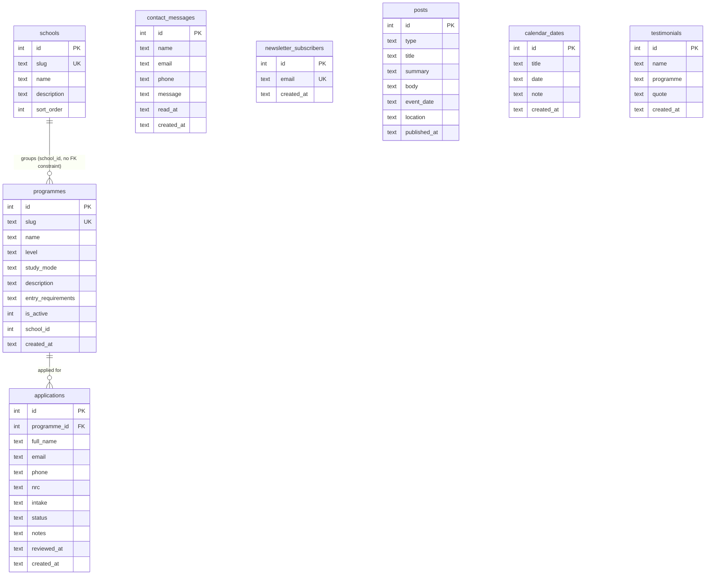

# Migration audit and plan: React, Express and the database

**Status:** Audit complete. No application code has been changed. Implementation is waiting on the decisions in [section 9](#9-decisions-needed-before-implementation).
**Audit date:** 28 October 2026

---

## 1. Summary

The project is the North End College website, admissions system and admin dashboard. It has about 3,900 lines of code: Node.js and Express, a SQLite database, and plain HTML, CSS and JavaScript with no framework and no build step.

**The most important finding:** the migration brief describes a university management system with student records, semester registration, course enrolment and results. **None of those modules exist in this project today.** The system stops at admission applications. It has no student records, academic years, semesters, courses, enrolments, grades, user accounts or roles.

So "migrate the entire existing application to React" covers:

- **8 public pages:** Home, About, Admissions, Programmes, Programme detail, News & Events, Contact, and 404.
- **The admin dashboard:** sign-in, Applications, Messages, Subscribers, News & Events, Important Dates and Testimonials.

Everything in brief sections 5B–5E beyond applications would be **new functionality**. It depends on university policies (credit limits, grading, progression and so on) that the brief says not to invent. Those are listed in [section 9](#9-decisions-needed-before-implementation).

---

## 2. Technology inventory

| Layer | Current implementation | Notes |
| --- | --- | --- |
| Frontend | 9 static HTML pages, 2 CSS files, 6 JS files, 1 SVG logo | No framework, no build step, no third-party JS libraries. Google Fonts (Montserrat, Open Sans). |
| Backend | Node.js 24 and Express 4.21 | Express is the only npm dependency. It has its own `.env` loader, rate limiter and security headers. |
| Database | SQLite 3.53 through Node's built-in `node:sqlite` | The `node:sqlite` module is still experimental in Node. The database is the single file `data/college.db` (WAL mode). |
| Migrations | Custom runner (`backend/migrate.js`), SQL files with up/down sections | 10 migrations, all applied, recorded in `schema_migrations`. |
| Authentication | One shared `ADMIN_TOKEN`, sent in the `X-Admin-Token` header | There are no users, passwords or roles. The token is kept in the browser's sessionStorage. |
| Tests | None | No test runner, linter or CI. |
| Version control | **None** | The folder is not a git repository. |
| This machine | PostgreSQL 15.19 service running on port 5432 | Installed at `C:\Program Files\PostgreSQL\15`. Docker Desktop is installed but not running. MySQL is not installed. |

---

## 3. Page and module inventory

### 3.1 Public site

| Route | Files | What the page contains | Data | React replacement |
| --- | --- | --- | --- | --- |
| `/` | `index.html`, `js/home.js` | Hero with intake badge and how-to-apply card, 4 quick links, school cards, programme tabs by school, about section with animated counters, Why NEC features, news/events/important dates (hidden when empty), student voices (hidden when empty), call to action, get in touch | `GET /api/schools`, `/api/programmes`, `/api/posts`, `/api/calendar`, `/api/testimonials` | `pages/public/HomePage` |
| `/about` | `about.html` | Story, promise and motto, Why NEC, student support, call to action | Static | `AboutPage` |
| `/admissions` | `admissions.html` | Overview and facts, WhatsApp box, 4 steps, entry requirements, **application form**, FAQ | `GET /api/programmes`, `POST /api/applications` | `AdmissionsPage`, `ApplicationForm` |
| `/programmes` | `programmes.html`, `js/programmes.js` | School filter and text search; the selected school is kept in the URL (`?school=`) | `GET /api/schools`, `/api/programmes` | `ProgrammesPage` |
| `/programmes/:slug` | `programme.html`, `js/programme.js` | Facts, overview, entry requirements, apply card, related programmes, Course structured data, not-found state | `GET /api/programmes/:slug` | `ProgrammeDetailPage` |
| `/news` | `news.html`, `js/news.js` | All news (expandable), upcoming events, important dates; opens a linked post (`#post-N`) | `GET /api/posts`, `/api/calendar` | `NewsPage` |
| `/contact` | `contact.html` | Contact details, **message form**, campus map (Google Maps embed) | `POST /api/contact` | `ContactPage` |
| any other | `404.html` | Not-found page with links | Static | `NotFoundPage` |

**Shared on every page** (`js/site.js`):

- Top bar with the intake announcement and contacts.
- Sticky header with dropdown navigation. The Academics menu is filled with schools from the API.
- Mobile menu.
- Footer with link columns and the **newsletter form** (`POST /api/newsletter`).
- Floating WhatsApp button.
- Data-driven widgets: features, contact list, WhatsApp box, phone links.
- Generic form handling that shows API field errors.

The React replacements are `layouts/PublicLayout` plus shared components.

### 3.2 Admin dashboard (`/admin`: `admin.html`, `js/admin.js`, `css/admin.css`)

| View | Features | Endpoints | React replacement |
| --- | --- | --- | --- |
| Sign-in | Token form; remembers the token for the tab | `GET /api/admin/summary` | `pages/admin/LoginPage` |
| Shell | Sidebar with grouped navigation and live counts, top bar with global search (Ctrl/⌘K), notifications bell, toast messages, off-canvas sidebar on mobile | `GET /api/admin/summary` | `layouts/AdminLayout` |
| Applications | See the list below | `GET`/`POST`/`PATCH /api/admin/applications`, `PATCH /api/admin/applications/:id` | `ApplicationsPage`, `ApplicantDrawer`, `NewApplicationDialog` |
| Messages | All/unread filter, reply by email or WhatsApp (marks the message read), call, mark read/unread, delete | `GET`/`PATCH`/`DELETE /api/admin/messages` | `MessagesPage` |
| Subscribers | Count cards, search, remove, copy all addresses, CSV export | `GET`/`DELETE /api/admin/subscribers` | `SubscribersPage` |
| News & Events, Important Dates, Testimonials | Shared add form, list and delete | `GET`/`POST`/`DELETE /api/admin/content/:resource` | `ContentEditorPage` (one component for all three) |

The Applications view has:

- 4 count cards (total, pending, accepted, rejected). Clicking one filters by that status.
- Search by name, NRC, phone, email or reference, plus programme and status filters.
- Row selection with bulk accept, reject or reset to pending.
- Pagination at 10 per page, and quick actions on each row.
- A review drawer with a status switch, applicant details, WhatsApp/call/email with pre-filled messages, and internal notes.
- A New application dialog and CSV export.

### 3.3 Workflows

1. **Online application:** the applicant submits the form and the application is saved as `pending`. An admin reviews it in the drawer, contacts the applicant on WhatsApp, and sets it to accepted or rejected, with notes. *The acceptance letter is sent by hand on WhatsApp; the system does not generate letters.*
2. **Manual application:** an admin records a walk-in or phone application with New application.
3. **Enquiry:** a visitor's contact form message arrives in the admin inbox. The admin replies and marks it read.
4. **Newsletter:** a visitor subscribes and is added to the list, which admins can export.
5. **Publishing:** an admin adds news, events, dates or testimonials, and they appear on the public site. Events and dates show only while upcoming, and empty sections are hidden.

---

## 4. Business rules implemented today

| Rule | Where it is enforced |
| --- | --- |
| The applicant's programme must exist and be active | API (`backend/lib/applications.js`) |
| Full name is at least 3 characters | API |
| NRC format is `######/##/#` | API |
| Phone accepts `0XXXXXXXXX`, `260XXXXXXXXX` or `+260` plus 9 digits (or any other international `+` number with 8–15 digits) and is stored as `+260XXXXXXXXX` | API (`backend/lib/validate.js`) |
| Email is optional but must be valid if given | API |
| Application status is `pending`, `accepted` or `rejected` | Database `CHECK` and API |
| `reviewed_at` is set whenever an application's status changes | API |
| The intake defaults to `January 2027` | Database default (hard-coded) |
| A contact message needs a name of at least 2 characters, an email or phone, and a message of at least 5 characters | API |
| Newsletter emails are unique regardless of case; a repeat sign-up silently succeeds | Database `UNIQUE COLLATE NOCASE` |
| A post's type is `news` or `event`, events need a date, and dates use `YYYY-MM-DD` | API |
| Public pages show only events and dates on or after today | API queries |
| Public form submissions are limited to 20 per IP every 15 minutes | In-memory middleware |
| **Not enforced:** the same NRC can apply any number of times | Policy decision needed (see 9.6) |

Forms rely on API validation. The frontend uses `novalidate` and shows the errors the API returns next to each field.

---

## 5. Current database

There are 9 tables plus `schema_migrations`.

| Table | Rows | Purpose |
| --- | --- | --- |
| `schools` | 4 | Groups of programmes. **These four names are placeholders I created and need confirming.** |
| `programmes` | 10 | The diploma programmes from the intake poster |
| `applications` | 0 | Admission applications |
| `contact_messages` | 0 | Contact form messages |
| `newsletter_subscribers` | 0 | Newsletter list |
| `posts` | 1 | News and events (one seeded intake announcement) |
| `calendar_dates` | 0 | Important dates |
| `testimonials` | 0 | Student quotes |
| `schema_migrations` | 10 | Applied migrations |

The only real data is the programme catalogue, so a database migration carries little risk. It will still be backed up first.



**Schema issues:**

- `programmes.school_id` has no foreign key constraint. SQLite can't drop such a column in a down migration, so the constraint was left out.
- Dates and timestamps are stored as `TEXT`.
- `applications.intake` and `testimonials.programme` are free text, not references to other tables.
- There is no unique rule on applications (for example one per NRC per intake).

---

## 6. Browser storage and hard-coded data

| Kind | Where |
| --- | --- |
| sessionStorage | `adminToken` (`js/admin.js`) |
| localStorage, cookies | Not used |
| Hard-coded site details | `SITE` (name, tagline, motto, intake, address, phones, empty email and social links), `NAV` and `FEATURES` in `js/site.js` |
| Hard-coded copy | FAQ answers (`admissions.html`), the About story (**placeholder text**), contact details in the structured data (`index.html`) and meta description (`contact.html`) |
| Intake "January 2027" | Hard-coded in 4 places: the database default, `SITE.intake`, page copy and pre-filled messages |
| Database-backed | Schools, programmes, applications, messages, subscribers, posts, important dates, testimonials |

---

## 7. Technical issues and risks

1. **Shared admin token:** there are no individual accounts and no record of who changed what. Anyone with the token has full access.
2. **No automated tests,** so a migration can't be checked against the current behaviour automatically.
3. **No version control and no backups.**
4. **`node:sqlite` is experimental, and SQLite allows only one writer at a time.** That's fine at today's scale, but weak for many staff and students using registration at the same moment.
5. **The intake is hard-coded** in several places instead of being stored as a record.
6. **No duplicate-application guard.**
7. **A missing foreign key** on `programmes.school_id`.
8. **The rate limiter is in memory,** so it resets on restart and doesn't work across several server processes.
9. **Public pages are already partly rendered by JavaScript** (header, footer, programmes, news). A React single-page app keeps the same SEO profile.

---

## 8. Brief entities compared with what exists

| Brief entity | Exists? | Notes |
| --- | --- | --- |
| Faculties / schools | ✅ `schools` | The names are placeholders |
| Departments | ❌ | |
| Academic programmes | ✅ `programmes` | |
| Academic years | ❌ | |
| Semesters / terms | ❌ | Only the free-text intake on applications |
| Courses and course offerings | ❌ | No course catalogue exists, even on paper in the project |
| Lecturers / staff | ❌ | |
| Student profiles | ❌ | Applicants only |
| Registration numbers | ❌ | Applications show `NEC-00001`, derived from the row ID, for display only |
| Admission applications | ✅ `applications` | |
| Student documents | ❌ | Documents are sent on WhatsApp |
| Student status and academic history | ❌ | |
| Programme enrolment | ❌ | |
| Semester registration and course enrolment | ❌ | |
| Prerequisites, credit limits, approval workflows | ❌ | |
| Assessments, grades, results, transcripts, progression, retakes | ❌ | |
| Users, roles, permissions | ❌ | Single shared token |
| Audit logs | ❌ | |
| Notifications | Partly | In-app counts only (pending applications, unread messages) |
| Finance / fees | ❌ | The brief says to add this only if it exists; it does not |

---

## 9. Decisions needed before implementation

1. **Scope:** migrate the existing modules only, or also build the academic modules (students, academic years/semesters, courses, registration, enrolment, results)?
2. **Public site:** move it into the same React app, or migrate only the admin dashboard?
3. **Database:** PostgreSQL 15 (already installed on this machine), keep SQLite, or MySQL?
4. **Roles:** which roles are needed? A system administrator is always required.
5. **Academic policies,** needed only if the academic modules are in scope:
   - Student registration number format (for example `NEC/2027/0001`).
   - When an applicant becomes a student: on acceptance, after registration, or after paying fees.
   - Academic calendar: intakes per year (January only?), and semesters or terms per year.
   - The course catalogue for each programme: codes, titles, credits, and the year/semester in which each is taken. **This must come from the college.**
   - Credit-load limits per semester.
   - Prerequisites.
   - Registration deadlines, and who approves registrations.
   - Grading scale, pass marks and grade points.
   - Progression, repeat, retake and supplementary exam rules.
   - Whether students log in to a portal, and with what (registration number, NRC or email).
   - Whether fees are in scope.
6. **Duplicate applications:** may the same NRC apply more than once for the same intake?
7. **Placeholder content:** the four school names and the About story need confirming or replacing.

---

## 10. Proposed architecture

### 10.1 Frontend: React, Vite and React Router

This structure is adapted to the modules that actually exist. No empty academic folders will be created until those modules are approved.

```
frontend/
  index.html
  vite.config.js           # dev proxy /api → Express
  public/                  # logo.svg
  src/
    main.jsx
    App.jsx
    routes/                # route table, ProtectedRoute
    layouts/
      PublicLayout.jsx     # top bar, header and dropdown nav, footer, WhatsApp button
      AdminLayout.jsx      # sidebar, top bar, notifications, toast
    components/            # Icon, ProgrammeCard, NewsCard, EventItem, DateItem, Testimonial,
                           # ContactList, WhatsAppBox, Features, FormField, Badge, EmptyState,
                           # Pagination, Dialog, Drawer, Kpi
    pages/
      public/              # Home, About, Admissions, Programmes, ProgrammeDetail, News, Contact, NotFound
      admin/               # Login, Applications (+ ApplicantDrawer, NewApplicationDialog),
                           # Messages, Subscribers, ContentEditor
    services/              # api.js (fetch wrapper), publicApi.js, adminApi.js
    hooks/                 # useApi, usePageMeta, useToast
    context/               # AuthContext, ToastContext
    utils/                 # dates, phone, csv, site config (one place for intake and contacts)
    styles/                # existing styles.css and admin.css, reused as they are
```

The existing CSS is reused unchanged, so the React pages look identical. Components keep the same class names.

### 10.2 Backend: keep Express, add layers

```
backend/
  app.js, server.js, config.js
  db/            # connection, migrations, seeds
  routes/        # URL → controller
  controllers/   # HTTP in/out
  services/      # business rules and transactions
  validation/    # shared validators
  middleware/    # auth, roles, rate limit, errors
```

- **The API stays the same,** so the current HTML frontend keeps working throughout the migration.
- Express serves the built React app (`frontend/dist`) and sends unknown routes to it. `/sitemap.xml` and `/robots.txt` are kept.
- In development, Vite runs on port 5173 and passes `/api` requests to Express on port 3000.

### 10.3 Dependencies to add (kept to a minimum)

| Package | Why |
| --- | --- |
| `react`, `react-dom`, `react-router-dom` | Frontend |
| `vite`, `@vitejs/plugin-react` | Build and dev server |
| `pg` | Only if PostgreSQL is chosen |
| `vitest`, `@testing-library/react`, `jsdom` (dev only) | Frontend tests |

Passwords would be hashed with Node's built-in `crypto.scrypt`, so no extra package is needed. Backend tests would use Node's built-in `node:test`.

---

## 11. Migration phases

| Phase | Work | Done when |
| --- | --- | --- |
| **0. Safety** | `git init` and a first commit; a backup and restore script for the database; API tests that record **today's** behaviour as a baseline | The baseline tests pass against the current code |
| **1. Database** (if PostgreSQL) | Rewrite the 10 migrations for PostgreSQL with proper types and the missing foreign key; a data copy script that checks row counts; switch the connection | Row counts match and all baseline tests pass |
| **2. Backend structure and auth** | Split into controllers, services and validation; users, roles and permissions tables; scrypt-hashed passwords; sessions in httpOnly cookies instead of a token in the browser; role checks on every admin endpoint; audit log of who changed what | Role and permission tests pass, and baseline tests still pass |
| **3. React public site** | Scaffold Vite, then migrate each page and compare with screenshots of the current page at desktop and 390px widths | All 8 routes match the current pages; forms work against the API |
| **4. React admin** | Shell, login, Applications, Messages, Subscribers and the content editors | Every current admin feature works the same way; tests pass |
| **5. Switch-over** | Express serves the React build; the old HTML is removed after you confirm | Full regression run is clean |
| **6. Academic modules** (if approved) | Database design, API, React pages and tests for each approved module, built once the policies in 9.5 are supplied | Each module has its own checklist |

**Why this order:** the database is switched first, while it holds almost no data. Authentication comes before the React admin, so the new login screen only has to be built once.

---

## 12. Testing plan

- **Backend:** `node:test` suites run against the Express app with a separate test database. They cover validation, constraints, permissions and each workflow in section 3.3.
- **Frontend:** Vitest and Testing Library tests for forms, filters, pagination and the drawer and dialogs.
- **Visual comparison:** headless browser screenshots of every route at desktop and 390px, compared with the current pages.
- **Data:** row counts and integrity checks before and after any database migration.
- **Reporting:** every phase reports the actual test output. Untested features will not be marked complete.

---

## 13. Deliverables tracker

| # | Deliverable | Status |
| --- | --- | --- |
| 1 | Inventory of existing pages and modules | ✅ This document, sections 2–8 |
| 2 | Proposed React project structure | ✅ Section 10.1 (awaiting approval) |
| 3 | Migrated React implementation | ⏳ Phases 3–5 |
| 4 | Database ER diagram | ✅ Current schema (section 5); the target schema follows decisions 9.1 and 9.3 |
| 5 | SQL schema and versioned migrations | Current: `backend/migrations/001–010`. Target: Phase 1 |
| 6 | Data dictionary | ⏳ Phase 1 |
| 7 | Backend API documentation | Current: `README.md`. Full reference: Phase 2 |
| 8 | Setup instructions and `.env` examples | Current: `README.md`, `.env.example`. Updated each phase |
| 9 | Backup and restore instructions | ⏳ Phase 0 |
| 10 | Checklist of migrated modules and test results | ⏳ Updated each phase |
| 11 | Unresolved requirements and decisions | ✅ Section 9 |
